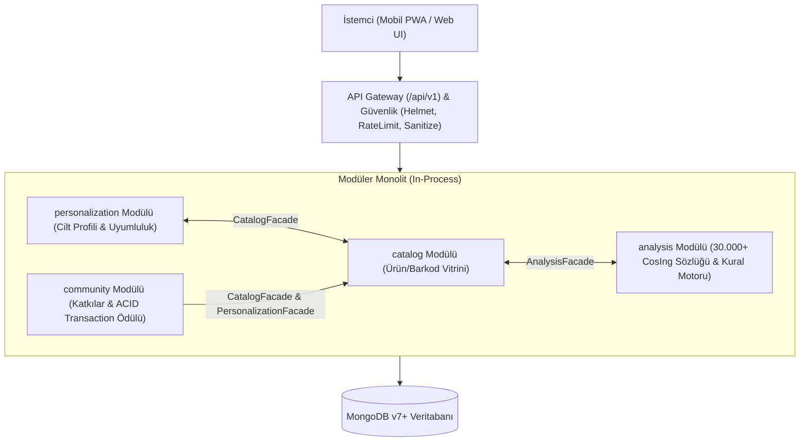

# INCI Engine (Kozmetik İçerik Analizi ve Cilt Uyumluluk Platformu)

[](https://github.com/inci-engine/inci-app/actions)
[](https://nodejs.org/)
[](https://www.mongodb.com/)
[](#mimari-modüler-monolit--clean-architecture)
[](LICENSE)

**INCI Engine**, tüketicilerin kozmetik ürün barkodlarını okuttuğunda veya serbest içerik metnini girdiklerinde; **AB Kozmetik Mevzuatı (EC No 1223/2009)** ve **30.000+ maddelik kimyasal sözlük** ile anında eşleşip ürün güvenliği, alerjen durumu ve kişiselleştirilmiş cilt uyumluluğu (Egzama, Roza, Mantar Aknesi) raporu üreten yeni nesil analiz platformudur.

---

## 1. Mimari: Modüler Monolit & Clean Architecture

Uygulama tek bir deploy edilebilir birim (monolith) olarak çalışır; ancak kod tabanında katı modül sınırları ve katmanlı yapı (`Presentation`, `Application`, `Domain`, `Infrastructure`) prensiplerine göre izole edilmiştir.



### Modül İzolasyon ve SOLID Kuralları
1. **Veri İzolasyonu:** Bir modül başka bir modülün veritabanı koleksiyonuna doğrudan sorgu atamaz (`db.collection` erişimi yasaktır).
2. **Facade Deseni:** Modüller arası iletişim YALNIZCA ilgili modülün `public/` klasöründe dışa açtığı Facade sınıfı üzerinden yürütülür.
3. **Dependency Inversion (DIP):** İş servisleri somut veritabanına değil soyut `Repository` arayüzlerine bağımlıdır. Birim testlerinde sahte depolarla (Mock) veritabanı olmadan saniyede test koşulabilir.
4. **Strategy Deseni:** AB regülasyon kuralları (`BannedIngredientRule`, `AllergenRule`, `PreservativeRule` vb.) bağımsız stratejiler olarak yazılmıştır (OCP).

---

## 2. Modül Haritası ve Sorumluluklar

| Modül | Klasör | Temel Görev | Dışa Açtığı Facade |
| :--- | :--- | :--- | :--- |
| **`core`** | `src/core/` | Yapılandırılmış loglama, `X-Correlation-ID`, merkezi hata yakalama, in-memory `EventBus`, DB havuzu. | - |
| **`analysis`** | `src/modules/analysis/` | 30.000+ AB CosIng kimyasal sözlüğü, toleranslı eşleme, Annex II-VI ve Alerjen kuralları, `SafetyScore` (0-100). | `AnalysisFacade` (`analyzeText`, `getIngredient`) |
| **`catalog`** | `src/modules/catalog/` | Ürün ve marka kataloğu, barkod araması, N+1 önleyen gömülü özet okuma. | `CatalogFacade` (`getProductByBarcode`, `createProductFromContribution`) |
| **`personalization`** | `src/modules/personalization/` | Bcrypt parola güvenliği, JWT, KVKK uyumlu cilt profili (Egzama, Roza, Mantar Aknesi) ve uyumluluk testi. | `PersonalizationFacade` (`addRewardPoints`, `checkProductCompatibility`) |
| **`community`** | `src/modules/community/` | Bulunamayan ürünler için kullanıcı katkıları, moderasyon ve ACID transaction ile 50 puan ödül akışı. | `CommunityFacade` (`submitContribution`) |

---

## 3. Kurulum ve Çalıştırma

### Gereksinimler
* Node.js (v20+ LTS önerilir)
* MongoDB (v6.0+ veya Docker)

### Adım 1: Bağımlılıkları Yükleyin
```bash
npm install
```

### Adım 2: Çevre Değişkenlerini Tanımlayın
```bash
cp .env.example .env
```

### Adım 3: Geliştirme Ortamında Başlatın
```bash
npm run dev
```

### Adım 4: Testleri Çalıştırın
```bash
npm test
```
*Tüm modüllerin birim, entegrasyon ve mimari sınır (arch-boundary) testleri otomatik koşulur.*

---

## 4. Docker ile Konteyner Çalıştırma

Tüm sistemi (Node.js backend + MongoDB) tek komutla ayağa kaldırmak için:

```bash
docker-compose up -d --build
```
* Sağlık kontrolü: `http://localhost:3000/health`
* Web Arayüzü: `http://localhost:3000`

---

## 5. RESTful API Uç Noktaları Rehberi

Tüm API yanıtları ve hataları `GEMINI.md` standardına uygun formatta döner.

### A) Sağlık ve Durum
* `GET /health` veya `GET /api/v1/health` - Sistem ve veritabanı durumunu döner.

### B) Analiz Motoru (`analysis`)
* `POST /api/v1/analyze` - Serbest içerik metnini analiz eder.
  ```json
  // Request
  { "ingredientsText": "Aqua, Glycerin, Niacinamide, Lilial, Parfum" }
  ```
* `GET /api/v1/ingredients/search?q=:name` - Kimyasal sözlükte arama yapar.
* `GET /api/v1/ingredients/:inci` - Tek bir kimyasalın regülasyon ve toksikoloji detayını getirir.

### C) Ürün ve Marka Kataloğu (`catalog`)
* `GET /api/v1/products/:barcode` - Barkod ile ürünün detayını ve gömülü analiz özetini tek hamlede getirir.
* `GET /api/v1/products/search?q=:query&category=:cat&page=1&limit=20` - Ürün arama.
* `GET /api/v1/brands` - Marka listesi.

### D) Cilt Profili ve Kimlik (`personalization`)
* `POST /api/v1/auth/register` - Kullanıcı kaydı (Bcrypt hash).
* `POST /api/v1/auth/login` - Giriş yapıp JWT token alır.
* `GET /api/v1/profile/skin` *(Auth)* - Kullanıcının cilt profilini döner.
* `PUT /api/v1/profile/skin` *(Auth)* - Cilt profilini günceller (Roza, Egzama, Mantar Aknesi).
* `POST /api/v1/profile/check-compatibility` - Bir ürünün kullanıcının cildine uygunluğunu dermatolojik kurallarla test eder.

### E) Topluluk ve Moderasyon (`community`)
* `POST /api/v1/contributions` *(Auth)* - Barkod ve ambalaj fotoğrafı ile ürün katkısı gönderir.
* `GET /api/v1/contributions/pending` - Onay bekleyen katkıları listeler.
* `POST /api/v1/contributions/:id/approve` - Katkıyı onaylar (ACID Transaction ile kataloğa eklenir ve kullanıcıya 50 puan tanımlanır).
* `POST /api/v1/contributions/:id/reject` - Katkıyı gerekçe belirterek reddeder.

---

## 6. Güvenlik ve KVKK / GDPR İlkeleri
* **Parola Güvenliği:** Asla düz metin saklanmaz; en az 10 tuzlu `bcrypt` ile tek yönlü hashlenir.
* **Hassas Sağlık Verisi Koruması:** Kullanıcının `skin_profile` bilgileri KVKK Madde 6 kapsamında loglara yazılmaz; JSON loglayıcı bu alanları `***HEALTH_DATA_MASKED***` olarak maskeler.
* **NoSQL Injection & Başlıklar:** `helmet` güvenlik başlıkları aktif edilir, parametreler DTO ve Value Object seviyesinde denetlenir.
* **Hata Maskeleme:** 500 hatalarında iç sistem yığını kullanıcıya verilmez; benzersiz `correlationId` ile izlenebilirlik sağlanır.
