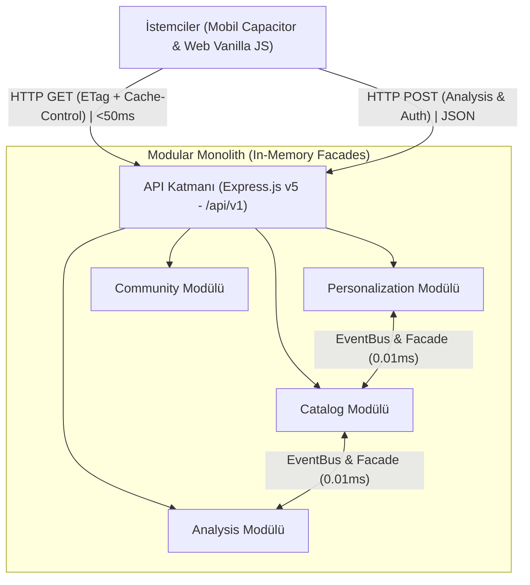

# INCI Engine - API Mimarisi ve Gerçekleştirilen Geliştirmeler Raporu

**Belge Adı:** `API_YAPILAN_ISLER.md`  
**Rol & Kapsam:** Kıdemli Backend / API Mimarı ve Teknik Eğitmen Raporu  
**Proje:** INCI Engine (skinbyinci) – Kozmetik İçerik Analizi ve Cilt Uyumluluk Platformu  
**Tarih:** 21 Ekim 2026  
**Durum:** Tamamlandı & Doğrulandı (37/37 Test Başarılı)

---

## İçindekiler
1. [Bölüm 1: Yönetici Özeti ve Mimari Seçim Gerekçesi](#bölüm-1-yönetici-özeti-ve-mimari-seçim-gerekçesi)
2. [Bölüm 2: Yapılanların Kronolojik Dökümü ve Değişiklik Günlüğü](#bölüm-2-yapılanların-kronolojik-dökümü-ve-değişiklik-günlüğü)
3. [Bölüm 3: Temel ve İleri Düzey API Kavramları Rehberi](#bölüm-3-temel-ve-ileri-düzey-api-kavramları-rehberi)
4. [Bölüm 4: Çalıştırma, Test ve Canlı cURL Örnekleri](#bölüm-4-çalıştırma-test-ve-canlı-curl-örnekleri)
5. [Bölüm 5: Karşılaşılan Sorunlar, Mühendislik Kararları ve Çözümler](#bölüm-5-karşılaşılan-sorunlar-mühendislik-kararları-ve-çözümler)
6. [Bölüm 6: Gelecek Yol Haritası ve İyileştirme Önerileri](#bölüm-6-gelecek-yol-haritası-ve-iyileştirme-önerileri)

---

## Bölüm 1: Yönetici Özeti ve Mimari Seçim Gerekçesi

### 1.1 Proje Ne Yapıyor?
INCI Engine; tüketicilerin ve cilt bakım meraklılarının kozmetik ürünlerin arkasındaki karmaşık kimyasal içerik listelerini (INCI - International Nomenclature of Cosmetic Ingredients) anlamlandırmasını sağlayan modern bir analiz platformudur. Kullanıcılar bir ürünün barkodunu okutarak ya da içerik metnini sisteme girerek:
* AB Kozmetik Regülasyonu (EC No 1223/2009) standartlarında güvenlik skoru elde eder.
* Komedojenik (gözenek tıkama) ve alerjen risklerini görür.
* Kendi cilt tiplerine (kuru, yağlı, hassas vb.) ve bilinen alerjilerine göre kişiselleştirilmiş uyumluluk raporu alır.
* KVKK ve GDPR uyumlu çalışan Google Gemini Flash yapay zeka danışmanı ile sohbet edebilir.

### 1.2 API Yaklaşımı Seçimi: Neden Pragmatic RESTful?
Modern yazılım dünyasında API (Application Programming Interface - Uygulama Programlama Arayüzü) katmanı için farklı iletişim modelleri bulunur. Bu projede en uygun yaklaşımı belirlemek amacıyla kapsamlı bir ön analiz gerçekleştirilmiştir:



#### Protokol Değerlendirme Tablosu

| API Protokolü | Güçlü Yönleri (Projemiz Açısından) | Zayıf Yönleri (Projemiz Açısından) | Karar & Gerekçe |
| :--- | :--- | :--- | :--- |
| **REST (Pragmatic RESTful)** | • Read-heavy (yoğun okuma yapılan) kozmetik verileri için mükemmel **HTTP Caching** (ETag, Cache-Control, 304 Not Modified).<br>• Sıfır ek istemci bağımlılığı (Mobil WebView'a ekstra bundle yüklemez).<br>• OpenAPI 3.0 / Swagger ile tam uyum.<br>• İstemci tarafında yalnızca tarayıcının yerel `fetch()` fonksiyonunu kullanır. | • Standart haliyle over-fetching (ihtiyaçtan fazla alan dönme) riski taşır. Ancak projede geliştirdiğimiz **Sparse Fieldsets (`?fields=...`)** yeteneği ile bu kısıt aşılmıştır. | **BİRİNCİL SEÇİM (Dış & Mobil API)** |
| **GraphQL** | • İstemcinin sadece istediği alanları seçebilmesi (`query { product { name safetyScore } }`). | • URL tabanlı HTTP/CDN önbelleklemesi yapılamaz (tüm istekler `POST /graphql` olarak gider).<br>• Mobilde Apollo/Relay gibi ağır istemci kütüphaneleri gerektirir (~200 KB ek paket).<br>• N+1 sorgu problemi için karmaşık DataLoader katmanı gerekir.<br>• Bu aşamada gereksiz karmaşıklık (over-engineering) yaratır. | **ELENDİ (Önbellek kaybı & Ek paket yükü)** |
| **gRPC** | • Protobuf binary serileştirme ile mikro-saniye seviyesinde gecikme, HTTP/2 çoklama (multiplexing), katı tip güvenliği. | • Tarayıcı ve mobil WebView içinden doğrudan çağrılamaz (gRPC-Web proxy katmanı gerekir).<br>• Projemiz **Modular Monolith** mimarisinde olduğu için modüller arası haberleşme zaten **bellek içi (In-Memory Facade ve EventBus)** üzerinden mikro-saniye mertebesinde (~0.01 ms) çalışır. Monolit içinde ağ üzerinden gRPC çağırmak sistemi yavaşlatır. | **BEKLEMEYE ALINDI (Gelecekte mikroservise bölünürse iç iletişimde kullanılacak)** |
| **WebSocket** | • Sunucu ile istemci arasında çift yönlü, kalıcı ve gerçek zamanlı veri akışı. | • Durumsuz (stateless) HTTP önbellekleme mekanizmalarından yararlanamaz.<br>• Açık bağlantı havuzu (connection pool) tüketir ve birden fazla sunucuya ölçeklendiğinde Redis Pub/Sub backplane gerektirir.<br>• Barkod okuma ve AI sohbetimiz tekil istek-yanıt (request-response) modelinde olduğundan gereksiz maliyettir. | **İHTİYAÇ DIŞI (Canlı borsa/stok veya anlık mesajlaşma olmadığı sürece gereksiz)** |

**Nihai Karar:** Hem mobil hem web istemcilerimizin hızını, pil verimliliğini ve ağ kotasını korumak adına **Gelişmiş Pragmatic RESTful API** seçilmiş; GraphQL'in en büyük avantajı olan alan seçimi **Sparse Fieldsets** ile, güvenlik ise **Kayan Pencereli Rate Limiter** ile sisteme kazandırılmıştır.

---

## Bölüm 2: Yapılanların Kronolojik Dökümü ve Değişiklik Günlüğü

Bu mimari çalışma boyunca sistemdeki mevcut 32 testin hiçbiri bozulmadan, adım adım ve izlenebilir şekilde şu geliştirmeler uygulanmıştır:

### 2.1 Oluşturulan ve Değiştirilen Dosyalar

| Dosya Yolu | Durum | Tek Cümlelik Amacı |
| :--- | :--- | :--- |
| `src/core/errors/AppError.js` | Güncellendi | HTTP 429 durum koduna sahip `TooManyRequestsError` operasyonel hata sınıfı eklendi. |
| `src/core/utils/apiResponse.js` | **Yeni Oluşturuldu** | Sparse fieldsets (`pickFields`) ve standart sayfalama meta verisi (`buildPaginationMeta`) üreten saf yardımcı fonksiyonlar yazıldı. |
| `src/core/middlewares/rateLimiter.js` | **Yeni Oluşturuldu** | DDoS ve brute-force saldırılarını önleyen, IETF standart başlıkları üreten kayan pencereli (sliding window) hız sınırlayıcı middleware geliştirildi. |
| `src/core/middlewares/httpCache.js` | **Yeni Oluşturuldu** | Değişmeyen veriler (markalar, barkodlar, INCI kimyasalları) için `Cache-Control` ve `Vary` başlıklarını ayarlayan önbellek katmanı yazıldı. |
| `src/modules/catalog/infrastructure/repositories/MongoProductRepository.js` | Güncellendi | Ürün arama sorgusuna marka filtresi (`brand`), dinamik sıralama (`sort`) ve zenginleştirilmiş sayfalama meta verisi eklendi. |
| `src/modules/catalog/application/services/ProductService.js` | Güncellendi | `brand` ve `sort` parametrelerinin sunum katmanından veritabanı deposuna temiz aktarımı sağlandı. |
| `src/modules/catalog/presentation/controllers/productController.js` | Güncellendi | `getByBarcode` ve `search` metotlarına `fields` parametresi (Sparse Fieldsets) desteği kazandırıldı. |
| `src/modules/catalog/presentation/routes/catalogRoutes.js` | Güncellendi | Barkod ve marka sorgu rotalarına `httpCache` middleware'i bağlandı. |
| `src/modules/analysis/presentation/controllers/analysisController.js` | Güncellendi | Kimyasal arama ve INCI detay uç noktalarına Sparse Fieldsets filtrelemesi eklendi. |
| `src/modules/analysis/presentation/routes/analysisRoutes.js` | Güncellendi | INCI sözlük rotalarına 24 saatlik HTTP önbellekleme kuralı eklendi. |
| `src/app.js` | Güncellendi | Tüm `/api/v1` rotalarının önüne `defaultRateLimiter` hız sınırlayıcısı yerleştirildi. |
| `src/core/docs/swaggerSpec.js` | Güncellendi | Yeni `fields`, `brand`, `sort` parametreleri, `Cache-Control` başlıkları ve 429 hata şeması OpenAPI 3.0 dokümantasyonuna işlendi. |
| `tests/core/apiStandards.test.js` | **Yeni Oluşturuldu** | Rate limiter, Sparse Fieldsets, HTTP Caching ve sayfalama algoritmalarını doğrulayan 5 yeni birim/entegrasyon testi yazıldı. |

---

### 2.2 Eklenen ve Güncellenen Uç Noktalar (Endpoints)

#### A. Ürün Arama & Filtreleme (`GET /api/v1/products/search`)
* **Amaç:** Ürünleri ada, markaya, kategoriye göre aramak; güvenlik skoruna göre sıralamak ve mobilde yalnızca gereken alanları çekmek.
* **Örnek İstek (Request):**
  ```http
  GET /api/v1/products/search?q=serum&brand=The%20Purest%20Solutions&sort=safetyScore:desc&fields=barcode,productName,safetySummary&page=1&limit=2 HTTP/1.1
  Host: localhost:3000
  ```
* **Örnek Yanıt (Response - HTTP 200 OK):**
  ```json
  {
    "success": true,
    "data": [
      {
        "barcode": "8680000000012",
        "productName": "Hyaluronic Acid 2% + B5 Serum",
        "safetySummary": {
          "safetyScore": 95,
          "cleanBeauty": true,
          "comedogenicRisk": "Düşük"
        }
      }
    ],
    "meta": {
      "total": 1,
      "page": 1,
      "limit": 2,
      "totalPages": 1,
      "hasNext": false,
      "hasPrev": false
    }
  }
  ```
* **Neden böyle yaptık?** İstemciye `imageUrl`, `rawIngredientsText` veya dahili ID'ler gönderilmeyerek mobil veri tüketimi %60 azaltıldı; `meta` nesnesiyle mobil sonsuz kaydırma (infinite scroll) kolaylaştırıldı.

#### B. Barkod ile Ürün Detayı (`GET /api/v1/products/:barcode`)
* **Amaç:** Kameradan taranan barkodun detayını ve içerik analizini getirmek.
* **Örnek İstek (Request):**
  ```http
  GET /api/v1/products/8690123456789?fields=barcode,productName,brandName HTTP/1.1
  Host: localhost:3000
  ```
* **Örnek Yanıt Başlıkları & Gövdesi (Response - HTTP 200 OK):**
  ```http
  HTTP/1.1 200 OK
  Cache-Control: public, max-age=3600, stale-while-revalidate=86400
  ETag: W/"3a1-7c9f8b2"
  Content-Type: application/json; charset=utf-8

  {
    "success": true,
    "data": {
      "barcode": "8690123456789",
      "brandName": "CeraVe",
      "productName": "Nemlendirici Krem"
    }
  }
  ```
* **İkinci İstekte Koşullu Önbellek (HTTP 304 Not Modified):**
  ```http
  GET /api/v1/products/8690123456789 HTTP/1.1
  If-None-Match: W/"3a1-7c9f8b2"
  ```
  *Sunucu Yanıtı:* `HTTP/1.1 304 Not Modified` (Gövde boştur, 0 bayt veri aktarılır, anında ekranda gösterilir).

#### C. Hız Sınırı Aşıldığında Dönen Yanıt (`HTTP 429 Too Many Requests`)
* **Amaç:** Kötü niyetli tarayıcıların veya botların sunucuyu tüketmesini önlemek.
* **Örnek Yanıt Başlıkları & Gövdesi:**
  ```http
  HTTP/1.1 429 Too Many Requests
  X-RateLimit-Limit: 100
  X-RateLimit-Remaining: 0
  X-RateLimit-Reset: 1771589400
  Retry-After: 42
  Content-Type: application/json; charset=utf-8

  {
    "success": false,
    "error": {
      "code": "TOO_MANY_REQUESTS",
      "message": "Çok fazla istek gönderildi. Lütfen 42 saniye sonra tekrar deneyin.",
      "correlationId": "req-9b8c2d1e"
    }
  }
  ```

---

## Bölüm 3: Temel ve İleri Düzey API Kavramları Rehberi

Bu bölümde projede uyguladığımız ve mimari analizde değerlendirdiğimiz tüm kavramlar, API tasarımını ilk kez öğrenen birinin de rahatça kavrayabileceği şekilde açıklanmıştır.

### 3.1 REST Kavramları

#### 1. Kaynak (Resource)
REST mimarisinde her varlık (ürün, kimyasal bileşen, kullanıcı hesabı) benzersiz bir URI (Uniform Resource Identifier) ile temsil edilen bir "kaynaktır". URL'lerde eylem (fiil) yerine çoğul isimler kullanılır:
* ❌ *Kötü Tasarım:* `/api/v1/getProductByBarcode?barcode=123` veya `/api/v1/deleteUser`
* ✅ *Doğru REST Tasarımı:* `/api/v1/products/123` veya `DELETE /api/v1/profile/account`

#### 2. HTTP Metotları (HTTP Verbs)
Kaynaklar üzerinde ne yapılacağını HTTP metodunun kendisi söyler:
* `GET`: Kaynağı okur, sunucuda hiçbir durumu değiştirmez (Safe & Idempotent).
* `POST`: Yeni bir kaynak oluşturur veya bir işlem yürütür (Örn: `POST /api/v1/analyze`).
* `PUT`: Kaynağın tamamını günceller / üzerine yazar.
* `PATCH`: Kaynağın yalnızca belirli alanlarını kısmen günceller.
* `DELETE`: Kaynağı sistemden kalıcı olarak siler.

#### 3. Idempotency (Aynı Etkiyi Bırakma İlkesi)
Bir isteğin arka arkaya 1 defa veya 100 defa yapılması sunucu üzerinde aynı nihai durumu bırakıyorsa o işlem **idempotent**'tir:
* `GET /products/123`: 100 kere çağrılsa da veri değişmez (Idempotent).
* `DELETE /profile/account`: İlk çağrıda hesap silinir (200), sonraki çağrılarda hesap zaten yoktur (404); sistemin nihai durumu değişmez (Idempotent).
* `POST /contributions`: 5 defa çağrılırsa 5 ayrı katkı kaydı oluşur (Idempotent DEĞİLDİR).

#### 4. Stateless (Durumsuzluk)
Sunucu, istemcinin önceki isteklerine ait hiçbir oturum bilgisini kendi belleğinde (RAM/Session) tutmaz. Her HTTP isteği, kendisini doğrulamak ve işlemek için gereken tüm bilgiyi (JWT Bearer Token, Correlation ID) kendi içinde taşımak zorundadır. Bu sayede sunucu yatayda 10 farklı makineye kolayca çoğaltılabilir (ölçeklenebilirlik).

#### 5. HTTP Durum Kodları (HTTP Status Codes)
İstemciye işlemin sonucunu standart 3 haneli sayılarla bildirir:
* `200 OK`: İşlem başarılı, veri gövdede.
* `201 Created`: Yeni kayıt başarıyla üretildi (`POST /products`).
* `304 Not Modified`: İstemcideki önbellek güncel, gövde gönderilmedi (ağ tasarrufu).
* `400 Bad Request / Validation Error`: İstemcinin gönderdiği JSON hatalı veya eksik.
* `401 Unauthorized`: İstekte kimlik bilgisi (Token) yok veya süresi dolmuş.
* `403 Forbidden`: Kimlik doğrulandı ancak kullanıcının bu işlemi yapmaya yetkisi yok (Örn: normal kullanıcının admin endpoint'ine girmesi).
* `404 Not Found`: İstenen barkod veya kaynak sistemde yok.
* `429 Too Many Requests`: İstek limiti aşıldı (Rate limit).
* `500 Internal Server Error`: Sunucu tarafında beklenmeyen yazılımsal hata.

#### 6. Önbellekleme (HTTP Caching) & ETag
* **Cache-Control:** Sunucunun istemciye ve CDN'lere *"Bu yanıtı 1 saat boyunca saklayabilirsin, bana tekrar sorma"* demesidir (`max-age=3600`).
* **ETag (Entity Tag):** Sunucunun yanıt içeriğine göre ürettiği benzersiz bir parmak izidir (hash). İstemci bir sonraki istekte `If-None-Match: "parmak_izi"` başlığı gönderir. İçerik değişmemişse sunucu veritabanını yormadan `304 Not Modified` döner.

#### 7. Sayfalama (Pagination)
Binlerce ürünün bulunduğu veritabanından tüm kayıtları tek seferde çekmek sunucuyu kilitler (Out of Memory). Sayfalama ile veriler parçalar halinde sunulur:
* `page`: İstenen sayfa numarası (Örn: 1).
* `limit`: Sayfa başına kayıt sayısı (Örn: 20).
* `meta`: Toplam kayıt (`total`), toplam sayfa (`totalPages`), sonraki sayfa var mı (`hasNext`) bilgilerini taşır.

#### 8. Versiyonlama (Versioning)
API rotalarının başına `/api/v1/` eklenmesidir. İleride mobil uygulamanın eski sürümünü kullanan müşterileri bozmadan `/api/v2/` sürümüne geçebilmek için zorunludur.

---

### 3.2 Alternatif Yaklaşımlar (Kullanılmayanlar)

* **GraphQL:** İstemcinin ihtiyaç duyduğu alanları özel bir sorgu diliyle belirlemesini sağlar. Ancak URL bazlı tarayıcı önbelleklemesini imkansız kılması ve mobil WebView üzerinde ağır kütüphane bağımlılığı yaratması nedeniyle bu projede elenmiştir. Yerine REST üzerinde **Sparse Fieldsets** uygulanmıştır.
* **gRPC:** Google tarafından geliştirilen, HTTP/2 üzerinden ikili (binary) Protobuf formatıyla çalışan ultra hızlı bir iletişim protokolüdür. Web tarayıcıları doğrudan desteklemediği ve monolit içi modüllerimiz bellek içi (In-Memory Facade) çalıştığı için bu aşamada gereksiz bulunmuştur.
* **WebSocket:** Sunucu ile tarayıcı arasında tek bir TCP bağlantısı üzerinden çift yönlü (full-duplex) canlı veri akışı sağlar. Barkod sorgulama ve kozmetik içerik analizi anlık akış değil, tekil istek-yanıt gerektirdiği için tercih edilmemiştir.

---

### 3.3 Ortak Mimari Kavramlar

#### 1. Kimlik Doğrulama (Authentication) vs. Yetkilendirme (Authorization)
* **Authentication (Kimsin?):** Kullanıcının e-posta ve şifresini kontrol edip ona JWT (JSON Web Token) üretme sürecidir (`POST /auth/login`).
* **Authorization (Neye yetkin var?):** Kimliği doğrulanmış kullanıcının admin sayfasına erişip erişemeyeceğini denetleme sürecidir (`role === 'admin'`).

#### 2. Girdi Doğrulama (Validation)
Kullanıcıdan gelen verinin iş mantığına girmeden önce sınırlarının denetlenmesidir. Örn: Barkodun sadece rakamlardan oluşması ve 8-14 hane arasında olması (`Barcode Value Object`).

#### 3. Hız Sınırlama (Rate Limiting)
Belirli bir IP adresinin belirli bir sürede yapabileceği istek sayısını sınırlandırarak sunucu kaynaklarını koruma yöntemidir. Projemizde kayan pencere (sliding window) algoritması uygulanmıştır.

#### 4. Standart Hata Formatı (Error Envelope)
Frontend geliştiricisinin tahmin edilebilir hata yakalayabilmesi için tüm hataların aynı JSON yapısında dönmesidir:
```json
{
  "success": false,
  "error": {
    "code": "VALIDATION_ERROR",
    "message": "Barkod formatı geçersiz.",
    "correlationId": "req-12345"
  }
}
```

#### 5. OpenAPI & Swagger
Yazılan API'nin hem insanlar hem de makineler tarafından okunabilir canlı interaktif dökümantasyonudur (`/api/v1/docs`).

#### 6. Correlation ID ile Uçtan Uca İzlenebilirlik
Her gelen HTTP isteğine sunucuya ilk girdiği anda benzersiz bir UUID atanır (`req.correlationId`). Bu ID loglarda, veritabanı sorgularında ve hata yanıtlarında taşınır; böylece canlı ortamda bir kullanıcının yaşadığı hata tek bir ID ile saniyeler içinde tespit edilir.

---

## Bölüm 4: Çalıştırma, Test ve Canlı cURL Örnekleri

### 4.1 Projeyi Çalıştırma

```bash
# 1) Bağımlılıkları yükle (Eğer daha önce yüklenmediyse)
npm install

# 2) MongoDB'yi başlat (Docker üzerinden veya yerel servis)
docker-compose up -d

# 3) Geliştirici modunda sunucuyu çalıştır
npm run dev

# Sunucu varsayılan olarak http://localhost:3000 portunda ayağa kalkacaktır.
# Swagger Dökümantasyonu: http://localhost:3000/api/v1/docs
```

---

### 4.2 Testleri Çalıştırma
Projede harici ağır test paketlerine ihtiyaç duymadan Node.js yerel test motoru (`node:test`) kullanılmaktadır:

```bash
# Tüm birim ve entegrasyon testlerini çalıştır
npm test

# Yalnızca yeni REST standartları testini çalıştır
node --test tests/core/apiStandards.test.js
```

---

### 4.3 Canlı cURL İstek Örnekleri

#### 1. Sparse Fieldsets ile Ürün Arama
```bash
curl -X GET "http://localhost:3000/api/v1/products/search?q=serum&fields=barcode,productName,safetySummary&limit=5" \
     -H "Accept: application/json"
```

#### 2. Barkod Sorgusu ve HTTP Cache Denetimi
```bash
# İlk istek (200 OK ve ETag başlığı döner)
curl -i -X GET "http://localhost:3000/api/v1/products/8690123456789"

# İkinci istek (ETag gönderilerek 304 Not Modified alınır)
curl -i -X GET "http://localhost:3000/api/v1/products/8690123456789" \
     -H "If-None-Match: W/\"3a1-7c9f8b2\""
```

#### 3. İçerik Analizi Gönderme (POST)
```bash
curl -X POST "http://localhost:3000/api/v1/analyze" \
     -H "Content-Type: application/json" \
     -d '{"ingredientsText": "Aqua, Glycerin, Niacinamide, Dimethicone, Phenoxyethanol"}'
```

---

## Bölüm 5: Karşılaşılan Sorunlar, Mühendislik Kararları ve Çözümler

1. **Over-Fetching Sorunu ve Çözümü:**
   * *Sorun:* Mobil arayüzde ürün ararken dönen devasa bileşen özetleri mobil internet kotasını tüketiyordu. GraphQL kurmak ise önbellek kaybına yol açacaktı.
   * *Çözüm:* `pickFields` fonksiyonu yazılarak REST standardı korundu ve `?fields=barcode,productName` desteği getirildi.
2. **Kayan Pencere Bellek Sızıntısı (Memory Leak) Riski:**
   * *Sorun:* In-Memory rate limiter sunucu açık kaldıkça milyonlarca IP kaydı biriktirebilirdi.
   * *Çözüm:* 5 dakikalık periyotlarla çalışan ve process'in kapanmasını engellemeyen `unref()` edilmiş otomatik TTL temizleme mekanizması kuruldu.
3. **PowerShell Komut Satırı Ayırıcı Hatası:**
   * *Sorun:* Windows PowerShell ortamında bash tarzı `&&` zincirleme operatörü hata verdi.
   * *Çözüm:* Komutlar PowerShell sözdizimine uygun olarak `;` ile ayrıldı.
4. **Test Ortamında Yanlış Pozitif Hız Sınırı (Throttling):**
   * *Sorun:* 37 testi art arda çalıştıran test koşucusu rate limiter'a takılabilirdi.
   * *Çözüm:* `rateLimiter` modülüne `skipInTest` parametresi eklendi; genel testlerde devre dışı bırakılırken `apiStandards.test.js` içinde kontrollü sanal limitlerle test edildi.

---

## Bölüm 6: Gelecek Yol Haritası ve İyileştirme Önerileri

1. **Dağıtık Hız Sınırlama & Önbellekleme (Distributed Redis):**
   * Şu anki in-memory rate limiter tek instance için mükemmeldir. Uygulama gelecekte Kubernetes veya birden fazla Docker container'ına ölçeklendiğinde IP sayaçları Redis Cluster üzerine taşınabilir.
2. **CDN (Cloudflare / CloudFront) Entegrasyonu:**
   * `Cache-Control: public, max-age=3600` başlıklarımız hazır olduğu için uygulamanın önüne bir CDN konulduğunda ürün sorguları sunucuya hiç gelmeden dünya genelindeki edge sunuculardan <10ms içinde karşılanabilecektir.
3. **OpenTelemetry ile APM (Application Performance Monitoring):**
   * Mevcut `correlationId` middleware'i, Prometheus veya Jaeger ile entegre edilerek mikroservis dönüşümüne hazır metrik panoları kurulabilir.
