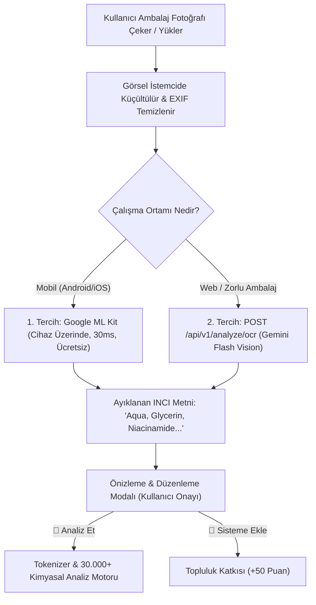

# INCI Engine - Optik Karakter Tanıma (OCR) ve Topluluk Puanlama (Gamification) Rehberi

**Belge Konumu:** `docs/OCR_VE_PUANLAMA_REHBERI.md`  
**Proje:** INCI Engine (skinbyinci)  
**Tarih:** 22 Ekim 2026  
**Durum:** Tamamlandı & Doğrulandı (41/41 Test Başarılı)

---

## İçindekiler
1. [Bölüm 1: Neden OCR ve Kitle Kaynaklı Puanlama?](#bölüm-1-neden-ocr-ve-kitle-kaynaklı-puanlama)
2. [Bölüm 2: OCR Çalışma Mimarisi (Hibrit On-Device & Gemini Vision)](#bölüm-2-ocr-çalışma-mimarisi-hibrit-on-device--gemini-vision)
3. [Bölüm 3: Topluluk Katkısı ve Oyunlaştırma (Gamification) Sistemi](#bölüm-3-topluluk-katkısı-ve-oyunlaştırma-gamification-sistemi)
4. [Bölüm 4: Eklenen ve Güncellenen Dosyaların Listesi](#bölüm-4-eklenen-ve-güncellenen-dosyaların-listesi)
5. [Bölüm 5: Nasıl Çalıştırılır, Test Edilir ve cURL Örnekleri](#bölüm-5-nasıl-çalıştırılır-test-edilir-ve-curl-örnekleri)

---

## Bölüm 1: Neden OCR ve Kitle Kaynaklı Puanlama?

### 1. Problem
* Piyasada 500 binden fazla kozmetik ürünü bulunmaktadır.
* Bazı ürünlerin barkodları ambalaj üzerinde silinmiş, yırtılmış olabilir ya da ürün henüz veritabanımızda kayıtlı olmayan yeni bir ürün olabilir.
* Sadece barkoda bağlı bir sistem, barkodu okunamayan ürünlerde tıkanır.

### 2. Çözüm: OCR + Crowdsourcing
* **OCR (Optik Karakter Tanıma):** Kullanıcı ambalajın arkasındaki minik *"Ingredients / İçindekiler"* yazısının fotoğrafını çeker veya kamerayı tutar. Yapay zeka bu görseldeki yazıları okuyup doğrudan kimyasal INCI sözlüğümüzle eşleştirir.
* **Topluluk Katkısı (Crowdsourcing):** Veritabanında olmayan bir ürün okutulduğunda kullanıcı soğuk bir hata mesajı yerine samimi bir davet alır: *"Bu ürünü ilk keşfeden sen ol, sisteme ekle ve 50 Puan kazan!"*. Böylece veritabanımız kullanıcıların katkılarıyla organik ve ücretsiz büyür.

---

## Bölüm 2: OCR Çalışma Mimarisi (Hibrit On-Device & Gemini Vision)



### Strateji Deseni (Strategy Pattern):
1. **Mobilde (Capacitor):** `CapacitorOcrStrategy` devreye girer. Google ML Kit'i telefonun kendi GPU'sunda çalıştırır (sıfır internet, anında okuma).
2. **Web / Masaüstü:** `BackendVisionOcrStrategy` devreye girer. Görsel `POST /api/v1/analyze/ocr` uç noktasına iletilir ve `GeminiVisionOcrService` görseldeki kıvrımlı/parlamalı metinleri analiz eder.

---

## Bölüm 3: Topluluk Katkısı ve Oyunlaştırma (Gamification) Sistemi

### 1. Kullanıcı Puanlarıyla Ne Yapacak?
* **Sınırsız AI Danışmanı:** Günde 3 soru limiti olan kullanıcılar 200 puanla 1 hafta boyunca sınırsız soru sorma veya kişisel haftalık rutin çıkartma hakkı kazanır.
* **Marka İndirimleri & Numuneler (B2B):** 500 puan biriktirenler anlaşmalı temiz kozmetik markalarından (The Purest Solutions vb.) indirim kodu veya tester numune kutusu kazanır.
* **Topluluk İtibarı ve Rozetler:** Kullanıcının profil sayfasında seviyesi sergilenir:
  * 🥉 **0 - 99 Puan:** *Cilt Kaşifi*
  * 🥈 **100 - 499 Puan:** *İçerik Dedektifi*
  * 🥇 **500+ Puan:** *Dermokozmetik Gurusu*

### 2. Puan Kazanma Kuralları
* Yeni ürün ambalajı / barkodu ekleme: **+50 Puan** (Moderatör onaylayınca MongoDB ACID transaction ile bakiye güncellenir).
* Cilt profilini %100 tamamlama: **+30 Puan**.
* Hatalı içerik düzeltme: **+20 Puan**.

---

## Bölüm 4: Eklenen ve Güncellenen Dosyaların Listesi

| Dosya Yolu | Görevi ve İşlevi |
| :--- | :--- |
| `src/modules/analysis/infrastructure/ocr/GeminiVisionOcrService.js` | Ambalaj görselinden INCI kimyasal metinlerini ayıklayan çok modlu yapay zeka servisi. |
| `src/modules/analysis/presentation/controllers/AnalysisController.js` | `extractOcrText` metodu ile görseli karşılayan kontrolcü katmanı. |
| `src/modules/analysis/presentation/routes/analysisRoutes.js` | `POST /api/v1/analyze/ocr` rotasının tanımlanması. |
| `public/js/scanner/IOcrStrategy.js` | OCR stratejileri için ortak sözleşme arayüzü (Strategy Pattern). |
| `public/js/scanner/CapacitorOcrStrategy.js` | Mobilde yerel Google ML Kit motorunu çalıştıran strateji. |
| `public/js/scanner/BackendVisionOcrStrategy.js` | Web ve fallback ortamlarında sunucu Vision servisini çağıran strateji. |
| `public/js/scanner/ScannerService.js` | Kameradan anlık kare dondurma (`captureFrameFromVideo`) ve OCR tetikleme. |
| `public/js/services/communityService.js` | `POST /api/v1/contributions` uç noktasına ürün katkısı gönderen istemci servisi. |
| `public/js/views/HomeScanView.js` | Otomatik OCR geçişi, kamera vizöründen OCR butonu, tespit edilen içerik önizleme modalı ve kayıtsız barkod davet kartı. |
| `public/js/views/ProfileWizardView.js` | Profil sayfasında kullanıcının toplam puanını ve rozetini (Kaşif, Dedektif, Guru) gösteren banner. |
| `src/core/docs/swaggerSpec.js` | OpenAPI / Swagger arayüzüne `/analyze/ocr` uç noktasının eklenmesi. |
| `tests/analysis/ocrAnalysis.test.js` | OCR görsel ayrıştırma, hata durumları ve otomatik analiz test paketi (4 yeni test). |

---

## Bölüm 5: Nasıl Çalıştırılır, Test Edilir ve cURL Örnekleri

### 1. Testleri Koşma
```bash
# Sadece OCR testini çalıştır
node --test tests/analysis/ocrAnalysis.test.js

# Tüm test süitini (41 test) çalıştır
npm test
```

### 2. Canlı cURL ile OCR Endpoint'ini Test Etme
```bash
curl -X POST "http://localhost:3000/api/v1/analyze/ocr" \
     -H "Content-Type: application/json" \
     -d '{
       "image": "data:image/jpeg;base64,iVBORw0KGgoAAAANSUhEUgAAAAEAAAABCAYAAAAfFcSJAAAADUlEQVR42mNk+M9QDwADhgGAWjR9awAAAABJRU5ErkJggg==",
       "autoAnalyze": true
     }'
```
*Dönen Yanıt:*
```json
{
  "success": true,
  "data": {
    "ingredientsText": "Aqua, Glycerin, Niacinamide, Panthenol, Phenoxyethanol, Sodium Hyaluronate",
    "detectedProductName": "Örnek Nemlendirici Serum",
    "detectedBrand": "Tespit Edilen Marka",
    "confidence": "MEDIUM",
    "analysis": {
      "summary": {
        "score": 90,
        "isClean": true,
        "totalIngredients": 6
      }
    }
  }
}
```
